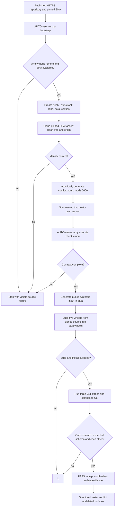

# Fresh user CPU run plan

The first public clone is the acceptance boundary. A local clone or copied model/data
cannot establish a pass. The synthetic CPU providers exercise packaging and file
contracts; they do not establish genuine generation, correction, or ERRANT quality.

## Command contract

| Program | Input | Output and side effects | Failure |
|---|---|---|---|
| `AUTO-user-run.py bootstrap` | HTTPS URL, full SHA, optional absolute base | Creates a new three-directory run root and the named tmuxinator user session; prints base, SHA and switch command | Refuses existing root, inaccessible source, wrong SHA, dirty clone |
| `AUTO-user-run.py execute` | `--base` absolute run root | Writes only under `data/` and reads generated `configs/.runrc`; prints progress and writes evidence | Stops at first failed gate; writes FAIL receipt |

The bootstrap owns all `.runrc` fields. It derives the SHA from the clone and
the paths from the fresh base, and replaces the file atomically. No manual field
entry or credential lookup is part of this CPU experiment.
